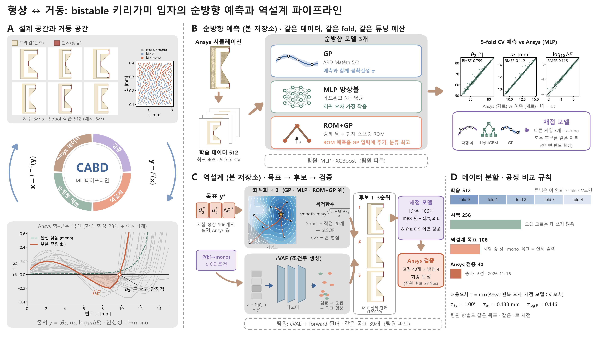
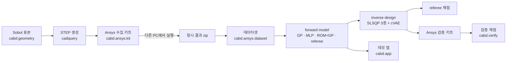

# CABD: 쌍안정 kirigami 입자의 forward prediction과 inverse design

연세대 MEU3801(컴퓨터해석기반설계) 기말 프로젝트의 ML 파트입니다.
물에 젖으면 형태가 바뀌는 쌍안정(bistable) kirigami 입자에서, **단면 치수 8개 → 거동**을 예측하는 forward model과 **원하는 거동 → 치수**를 찾는 inverse design을 만들고 Ansys로 검증했습니다.

## 문제

- **입력 x (설계 변수 8개, mm):** 팁 힌지 두께·길이 `t_h`, `L_h`, 꼭짓점 힌지 두께·길이 `t_a`, `L_a`, 팔 길이 `L`, 플랜지 두께 `t_f`, 꼭짓점-벽 간격 `c`, 공통 필렛 비율 `rho`. 범위와 의미는 [docs/DATA.md](docs/DATA.md).
- **상태 2개:** 살짝 젖음(partial, 힌지만 젖어 연함)과 완전 젖음(full). 형상마다 Ansys 변위 제어 해석 2번(15 mm).
- **출력 y:**
  - 안정성: 상태마다 bi / mono. 두 상태를 묶은 3-class `bi>bi`, `bi>mono`, `mono>mono`.
  - 회귀(살짝 젖음이 bi일 때): 두 번째 안정점의 팔 회전각 **θ₂** [°], 변위 **u₂** [mm], 역방향 에너지 장벽 **ΔE** [mJ] (학습은 log₁₀ΔE).
- **설계 목표:** 살짝 젖음에서는 쌍안정(형태 유지), 완전 젖음에서는 단안정(원래대로)인 **bi>mono**이면서 목표 (θ₂, u₂, ΔE)를 허용오차 τ 안에서 맞추는 형상.

## 파이프라인



그림은 팀 공유용으로 만든 것이라 팀원 파트 자리(점선 상자)가 함께 그려져 있습니다. 이 레포에는 그 부분이 없습니다.

코드 기준 흐름:



## 핵심 결과

**forward model (학습 512개, 5-fold cross-validation, 시드 5개 평균)** — [docs/RESULTS.md](docs/RESULTS.md#1-forward-model-5-fold-cv)

| 모델 | 3-class balanced acc | θ₂ RMSE (°) | u₂ RMSE (mm) | log₁₀ΔE RMSE | combined nRMSE |
|---|---|---|---|---|---|
| GP | 0.931 | 0.962 | 0.133 | 0.149 | 0.203 |
| MLP deep ensemble | 0.904 | **0.833** | **0.116** | **0.120** | **0.166** |
| ROM+GP | **0.957** | 1.012 | 0.131 | 0.141 | 0.196 |

**learning curve (시험 256개):** 학습 512 → 1,536개로 늘리면 combined nRMSE가 GP 0.210 → 0.135, MLP 0.206 → 0.136, ROM+GP 0.233 → 0.124로 줄었습니다.

**inverse design 1순위 후보 (512개 모델)** — [docs/RESULTS.md](docs/RESULTS.md#3-inverse-design)

| 방법 | referee 성공률 (106 질의, 시드 5개 평균) | Ansys 성공 (40 질의, 시드 0) | Ansys에서 bi>mono 맞음 | 최대 오차/τ 중앙값 |
|---|---|---|---|---|
| GP + SLSQP | 0.81 | **35/40** | **40/40** | 0.52 |
| ROM+GP + SLSQP | 0.68 | **35/40** | **40/40** | 0.53 |
| MLP + SLSQP | 0.21 | 30/40 | 32/40 | **0.26** |
| cVAE | 0.50 | 12/40 | 31/40 | 1.30 |

성공 = Ansys에서 bi>mono이고 세 출력 모두 |오차| ≤ τ (τ = θ₂ 1.00°, u₂ 0.138 mm, log₁₀ΔE 0.146).

**판정:** GP와 ROM+GP는 성공률과 오차 모두 통계적으로 구분되지 않습니다(Wilcoxon p = 0.51). 둘 다 bi>mono를 40개 모두 맞혔습니다. MLP는 클래스가 맞으면 가장 정확하지만 8개에서 클래스가 틀렸습니다. cVAE는 모든 기준에서 가장 낮습니다. 근거와 한계는 [docs/DECISIONS.md](docs/DECISIONS.md#d18-종합-판정).

## 레포 구조

```
src/cabd/
  config.py         경로(레포 기준 상대 경로)와 상수(변수 범위, τ, P_MIN, seed)
  geometry/         형상 파라미터화(params), Sobol 표본(sampling), STEP 생성(step)
  ansys/            Ansys 키트 빌더(kit, kits), 결과 읽기(results), 데이터셋(dataset), 결과 뷰어(viewer)
  data.py, metrics.py
  models/           gp, mlp, rom, rom_gp, cvae, referee + 저장·불러오기(io)
  fit.py            모델 학습
  evaluate/         cross-validation, learning curve, θ₂·u₂ joint 예측 실험, 역설계 질의
  inverse/          목적함수·SLSQP·후보 선택(core), 실행(run), referee 채점(score), 재실행(patch)
  verify/           Ansys 검증 후보와 채점
  app/              데모 앱(engine, server, static, bundle)
  plots/            그림
ansys_kit/          Ansys PC에 배포하는 키트 파일(job.wbjn, mech_job.py, template.wbpz, ...)
data/               데이터셋, 곡선, Sobol 표, 질의, fold
models/             git에 포함한 가중치(앱 번들, MLP 1,536, cVAE, ROM 계수) + MANIFEST.csv
results/            지표, OOF 예측, inverse 결과, Ansys 검증, 그림
tests/              원본 코드와 같은 결과를 내는지 확인하는 테스트(run_tests.py)
tools/              원본 가중치 변환 스크립트(1회용)
docs/               DECISIONS, RESULTS, DATA, REPRODUCE
```

## 빠른 시작

환경은 Python 3.12 두 개입니다(ML용, CAD용). 버전은 `pyproject.toml`에 고정했습니다.

```powershell
pip install -e .[ml]
```

데모 앱(학습 1,536개 모델, 가중치는 `models/`에 포함):

```powershell
$env:PYTHONPATH = "src"
python -X utf8 -m cabd.app.server --port 8765
```

브라우저에서 `http://localhost:8765`를 엽니다. Windows에서는 `tools/run_app.bat`도 같습니다.

테스트(원본 비교 테스트는 `CABD_LEGACY`가 없으면, 무거운 테스트는 `CABD_SLOW=1`이 아니면 건너뜀):

```powershell
python -X utf8 tests/run_tests.py
```

필터: `test_ml`, `test_ansys`, `test_geometry`, `inverse`, `app`.

STEP 생성, 키트 생성, 데이터셋 재생성, 학습, inverse, 검증 전 과정은 [docs/REPRODUCE.md](docs/REPRODUCE.md).

## 가중치와 큰 파일

- **git에 포함 (`models/`, 약 63 MB):** 데모 앱 번들 `app_models_n1536.joblib`, MLP 1,536개 5시드, cVAE, ROM 계수.
- **GitHub Release asset (`artifacts/`에 풀기):**
  - `artifacts/models/`: GP, ROM+GP, referee 전체와 나머지 학습 크기·시드(42개, 약 473 MB).
  - `artifacts/ansys_raw/`: Ansys 원시 결과 zip 12개(약 232 MB, 컴퓨터 이름·사용자 경로를 지운 사본). 데이터셋 재생성과 검증 채점에 씁니다.
- 목록과 sha256은 [models/MANIFEST.csv](models/MANIFEST.csv). 모든 가중치는 `cabd.fit`으로 다시 만들 수 있습니다.

## 문서

| 문서 | 내용 |
|---|---|
| [docs/DECISIONS.md](docs/DECISIONS.md) | 모든 선택의 이유: 선택 / 대안 / 근거 / 한계 |
| [docs/RESULTS.md](docs/RESULTS.md) | 평가 지표 전체(각 표의 근거 파일 경로 포함) |
| [docs/DATA.md](docs/DATA.md) | 설계 변수, 출력 정의, 데이터셋 열, 수집 규칙 |
| [docs/REPRODUCE.md](docs/REPRODUCE.md) | 환경, Release asset, 단계별 명령, 테스트 |
